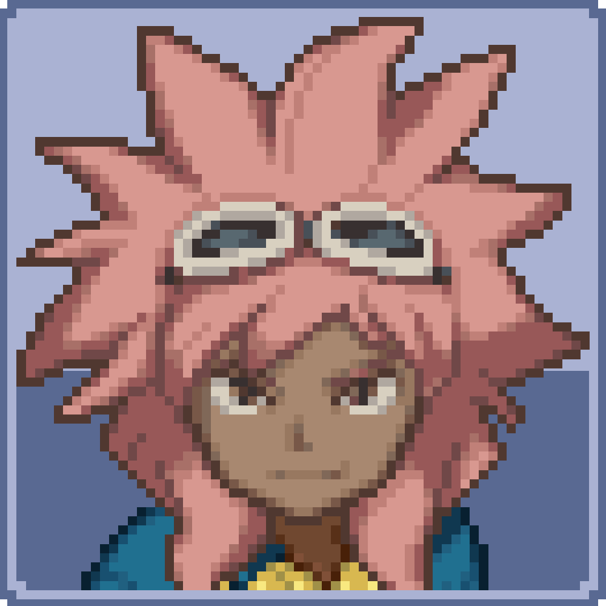

# Hurley - Hissatsu du jour 🏄


**Yo ! 🏄**
C'est moi, Hurley Kane ! Tous les matins, je vous balance une technique en image et vous devez trouver son nom.
Un seul essai, alors réfléchissez bien avant de sauter sur la vague ! 🌊

<br clear="left">

---

Bot Discord qui pose chaque matin un quiz sur les *hissatsu* (super techniques) d'Inazuma Eleven,
présenté par Hurley Kane. Une image, 4 propositions, un seul essai : Hurley te dit en privé si t'as bon.

Les données viennent de [HissatsuDle](https://github.com/nakzskea/hissatsudle) (879 techniques).
Projet de fan, sans aucun lien avec Level-5.


## Fonctionnement

| | |
|---|---|
| **Question du jour** | Postée chaque matin dans le salon. 4 boutons, 1 essai par personne, 1 point par bonne réponse |
| **`/entrainement`** | Une question visible par toi seul, à enchaîner autant que tu veux. Ne compte pas dans le classement |
| **`/classement`** | Le top 10 des joueurs |

Les 4 propositions sont toujours du même type et du même élément que la bonne réponse :
si c'est *Tornade de Feu*, les 3 autres sont aussi des tirs de feu.

## Architecture

Aucun serveur :

```
GitHub Actions (cron 8h) ──► API Discord : poste la question avec les boutons
                                   │
                         clic / commande slash
                                   ▼
                     Cloudflare Worker ──► Cloudflare KV
                   (vérifie la signature,   (votes, scores)
                    répond en éphémère)
```

- `scripts/hissatsu_du_jour.py` : tire la question et la poste (Python, bibliothèque standard uniquement)
- `worker.js` : reçoit les interactions Discord (boutons, `/entrainement`, `/classement`)
- `scripts/register_commands.py` : déclare les commandes slash (à lancer une fois)

## Installation

1. **Discord** : créer une application sur le [Developer Portal](https://discord.com/developers/applications),
   récupérer le token du bot et la clé publique, inviter le bot (scope `bot`, permissions *Voir les salons*,
   *Envoyer des messages*, *Intégrer des liens*).
2. **Cloudflare** : créer un Worker avec le contenu de `worker.js`, un namespace KV lié sous le nom `KV`,
   et une variable `PUBLIC_KEY`. Coller l'URL du Worker dans *Interactions Endpoint URL* du portail Discord.
3. **GitHub** : ajouter le secret de repository `DISCORD_TOKEN`, mettre l'ID du salon dans
   `CHANNEL_ID` (`scripts/hissatsu_du_jour.py`), puis lancer le workflow *Enregistrer les commandes*.
