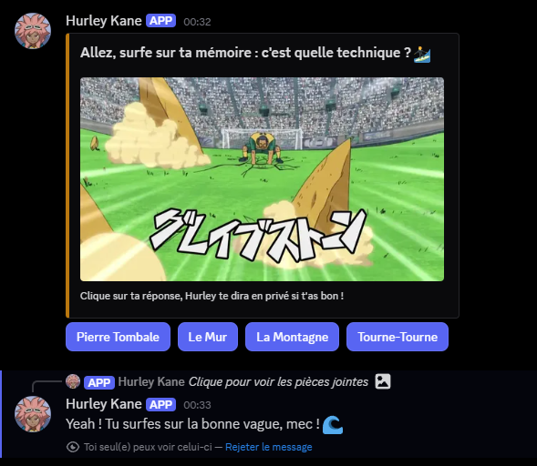

# Hurley - Hissatsu du jour 🏄


**Yo ! 🏄**
C'est moi, Hurley Kane ! Matin et aprem, je vous balance une technique en image et vous devez trouver son nom.
Un seul essai, alors réfléchissez bien avant de sauter sur la vague ! 🌊

<br clear="left">

---

Bot Discord qui pose deux quiz par jour sur les *hissatsu* (super techniques) d'Inazuma Eleven,
présenté par Hurley Kane. Une image, 4 propositions, un seul essai : Hurley annonce à tout le salon si t'as réussi ou raté,
et te glisse la bonne réponse en privé si tu t'es planté. Chaque dimanche soir, il dévoile le classement de la semaine.

Les données viennent de [HissatsuDle](https://github.com/nakzskea/hissatsudle) (879 techniques).
Projet de fan, sans aucun lien avec Level-5.



## Fonctionnement

| | |
|---|---|
| **Questions du jour** | Une le matin, une l'aprem. 4 boutons, 1 essai par personne, 1 point par bonne réponse. Résultat annoncé publiquement, bonne réponse en privé en cas d'erreur |
| **`/entrainement`** | Une question visible par toi seul, à enchaîner autant que tu veux. Ne compte pas dans le classement |
| **`/classement`** | Le classement de la semaine en cours |
| **Bilan du dimanche** | Chaque dimanche à 20h, Hurley annonce le classement de la semaine, félicite les gagnants et remet les compteurs à zéro. En cas d'égalité, même rang pour tout le monde |

Les 4 propositions sont toujours du même type et du même élément que la bonne réponse :
si c'est *Tornade de Feu*, les 3 autres sont aussi des tirs de feu.

## Architecture

Aucun serveur, 0 € : tout le bot tient dans un seul Cloudflare Worker.

```
Cron Triggers (matin, aprem, dimanche soir)
              │
              ▼
     Cloudflare Worker ──► API Discord : poste les questions et le bilan
              ▲   │
   clics /    │   └──► Cloudflare KV (votes, scores de la semaine)
   commandes  │
           Discord
```

- `worker.js` : tout le bot (questions, boutons, `/entrainement`, `/classement`, bilan hebdo). Vérifie la signature
  de chaque requête Discord, annonce les résultats en public et envoie la bonne réponse en privé
- `scripts/register_commands.py` + workflow *Enregistrer les commandes* : déclare les commandes slash (à lancer une fois)

## Installation

1. **Discord** : créer une application sur le [Developer Portal](https://discord.com/developers/applications),
   récupérer le token du bot et la clé publique, inviter le bot (scope `bot`, permissions *Voir les salons*,
   *Envoyer des messages*, *Intégrer des liens*).
2. **Cloudflare** : créer un Worker avec `worker.js` (mettre l'ID du salon dans `CHANNEL_ID`), lier un namespace KV
   sous le nom `KV`, ajouter la variable `PUBLIC_KEY` et le secret `DISCORD_TOKEN`, puis les Cron Triggers
   `0 7 * * *`, `0 12 * * *` et `0 19 * * SUN` (heures UTC). Coller l'URL du Worker dans *Interactions Endpoint URL*
   du portail Discord.
3. **GitHub** : ajouter le secret de repository `DISCORD_TOKEN`, puis lancer le workflow *Enregistrer les commandes*.
